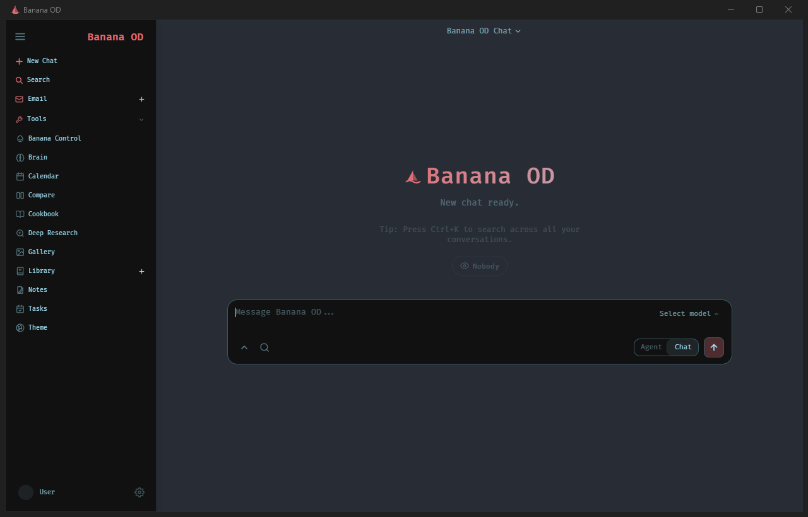

# Banana OD

**Eine lokale Windows-Arbeitsumgebung für KI-Chat, Agenten, Werkzeuge und Projekte.**

Banana OD verbindet normale KI-Unterhaltungen mit praktischer Arbeit auf dem eigenen PC. Je nach Freigabe können Modelle Dateien bearbeiten, Terminalbefehle ausführen, MCP-Dienste verwenden, Skills laden und größere Aufgaben in kontrollierte Schritte aufteilen.

  

## Funktionen

- KI-Chat und kontrollierte Agentenarbeit
- lokale und angebundene Cloud-Modelle
- Dateien, Terminal, MCP und Skills
- Projekt-, Aufgaben- und Wissensverwaltung
- Banana Control und AI-Hub-Integration
- Desktop Bridge und Agent Council mit Sicherheitskontrollen
- lokale Windows-App statt eines normalen Browser-Tabs

## Öffentlicher Stand

Der erste öffentliche, geprüfte Release wird vorbereitet. Installer, portable Version, passender Quellcode und Installationshinweise werden gemeinsam unter **Releases** veröffentlicht.

Bis dahin enthält dieses Repository bewusst keinen Download. Ungeprüfte Entwicklungsstände bleiben privat.

## Sicherheit

Banana OD kann mächtige lokale Werkzeuge verwenden. Zugriff sollte nur bewusst erteilt werden. Persönliche Daten, Passwörter und API-Schlüssel gehören niemals in geteilte Pakete oder Screenshots.

## Herkunft und Lizenz

Banana OD baut auf [Odysseus](https://github.com/odysseus-dev/odysseus) auf und erweitert es besonders für lokale Windows-Nutzung, kontrollierte Agentenarbeit und die AI-Hub-Integration.

Lizenz: **AGPL-3.0-or-later** – siehe [LICENSE](LICENSE). Jeder veröffentlichte Programmstand wird zusammen mit dem dazugehörigen Quellcode bereitgestellt.
